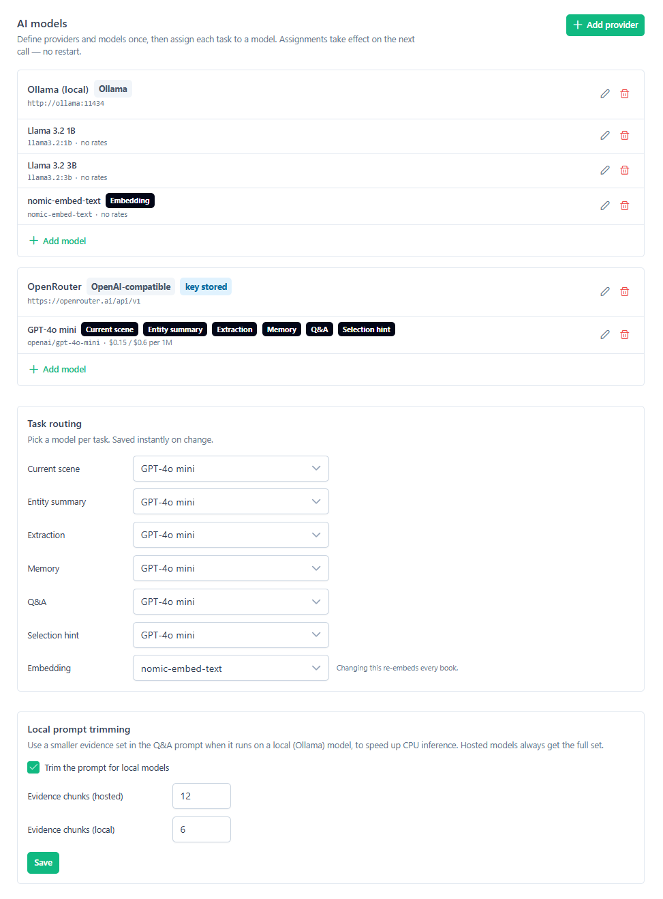

# Hosted (non-local) models

Storymark runs fully local by default: Ollama on the same box, `llama3.2:3b` and `llama3.2:1b` for chat tasks, `nomic-embed-text` for embeddings. That works everywhere, but small models extract sparser timelines, graphs, and entities than larger ones. Pointing some (or all) tasks at a hosted provider is the single biggest quality lever you have, and it needs no redeploy.

Any **OpenAI-compatible** endpoint works: OpenAI itself, OpenRouter, Groq, Together, Mistral, or a vLLM/llama.cpp server on a beefier box in your network.

## The trade you're making

Be aware of what leaves your server. Every task routed to a hosted model sends that task's prompt to the provider, and the prompt contains book excerpts as evidence. Two things stay true regardless of provider:

- The spoiler boundary is enforced before the call: evidence is filtered to the reader's position server-side, so a hosted model never sees further into the book than you have read.
- Every call lands in the LLM call log (admin → LLM Calls) with the evidence it saw, token counts, and cost, so you can audit exactly what was sent where.

If "book text goes to a third party" is unacceptable, stop here: the all-local default is the private option, and a self-hosted vLLM box gives you hosted-class quality without leaving your network.

## Setting it up

Everything happens in the admin panel under **AI models**. Changes take effect on the next call; nothing restarts.

1. **Add provider** — pick *OpenAI-compatible*, set the base URL (e.g. `https://openrouter.ai/api/v1`) and the API key. The key is encrypted at rest and write-only: the UI shows only that a key is stored, never the key itself.
2. **Add model** — the model id is whatever the provider expects (`openai/gpt-4o-mini` on OpenRouter, `gpt-4o-mini` on OpenAI directly). Set the input/output cost rates (per 1M tokens) from the provider's pricing page; the cost meter and call log use them.
3. **Task routing** — assign tasks to the new model. Each dropdown saves on change.

## Suggested routing

Not all tasks gain equally from a stronger model. Roughly in order of payoff:

| Task | What it does | Hosted payoff |
| ---- | ------------ | ------------- |
| Extraction | Builds the memory: events, entities, relationships, per-section summaries. Background, once per book. | **Highest.** This is where small models leave timelines and graphs sparse. Almost all of your token spend lands here. |
| Memory | Folds each section into the rolling "story so far". Background. | High. Better narrative coherence in recaps and the Summary tab. |
| Q&A | The assistant's free-text answers. Interactive. | High. Small local models sometimes hedge on answerable questions. |
| Entity summary | The "who is this?" cards. Generated on demand, then cached per position. | Medium. Generation latency is visible the first time you tap a name. |
| Current scene | The Scene tab. On demand, cached. | Medium. |
| Selection hint | The fast hint on a text selection. Latency-sensitive by design. | Low. The local 1B model is the point here; a fast hosted small model also works. |
| Embedding | Vector search over chunks. | **Leave local.** Changing the embedding model re-embeds every book (the panel warns you), and `nomic-embed-text` is fast even on CPU. |

Three setups that make sense:

- **All local** (the default). Free, private, slower extraction, sparser memory. Fine for trying Storymark out.
- **Hybrid**: hosted Extraction + Memory + Q&A, everything else local. Most of the quality for the least exposure; the latency-sensitive reader-time tasks never leave your box.
- **All hosted (except embedding)**: a cheap small hosted model on every chat task, as in the screenshot. Consistent quality everywhere; reader-time features get noticeably sharper.

## Settings worth touching

- **Local prompt trimming** (bottom of the AI models panel): the Q&A prompt uses a reduced evidence set on local models to keep CPU inference fast. Hosted models always receive the full set. With a large-context hosted model on Q&A you can raise *Evidence chunks (hosted)* above the default 12 for better recall on sprawling books; expect proportionally higher per-question cost.
- **Prompts** (admin → Prompts): the default prompts are written defensively for small local models. Hosted models handle them fine as-is, so only start editing if you're chasing a specific behaviour.
- **Reprocess after upgrading extraction**: changing the Extraction model affects future processing only. For books you've already indexed, admin → Books → *Reprocess* rebuilds their memory with the new model (progress and bookmarks are kept).

## Keeping an eye on cost

Extraction dominates: every section of a book goes through the model once at upload (or reprocess). Q&A costs per question; entity summaries, scene cards, and recaps are generated once per reading position and then served from cache. The admin cost meter totals it all from the per-model rates you entered, and the call log shows the spend per call when you want to know where it went.
