# Screenshots

All taken on a phone in the sepia theme, reading *The Book of Koli*. The same UI scales up to tablet and desktop.

## Reading

<table>
  <tr>
    <td align="center">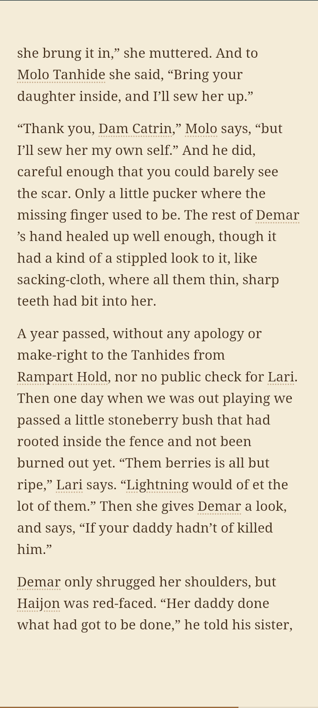 The reader</td>
    <td align="center">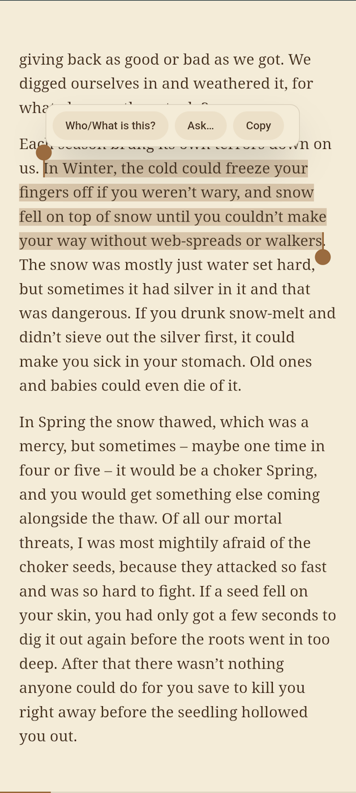 Select anything, ask about it</td>
    <td align="center">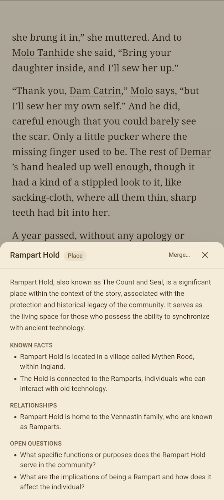 Spoiler-safe entity cards</td>
  </tr>
</table>

## The Memory panel

Every tab filters to the exact reading position — nothing from chapters you haven't reached.

<table>
  <tr>
    <td align="center">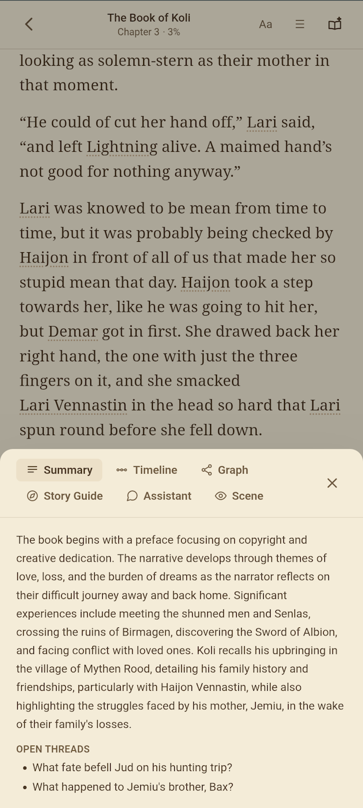 The story so far</td>
    <td align="center">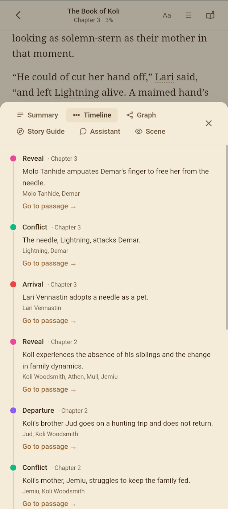 Event timeline</td>
    <td align="center">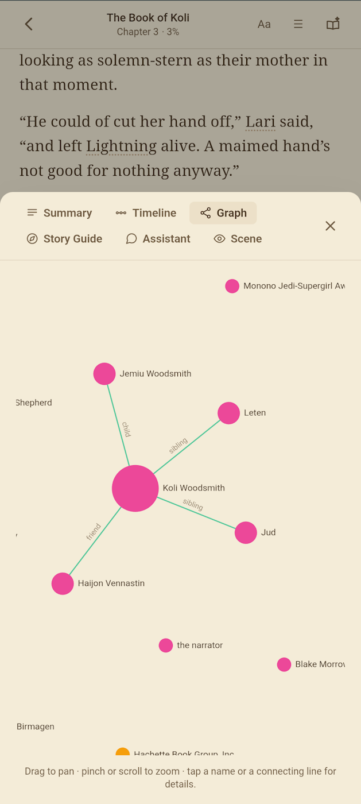 Relationship graph</td>
  </tr>
  <tr>
    <td align="center">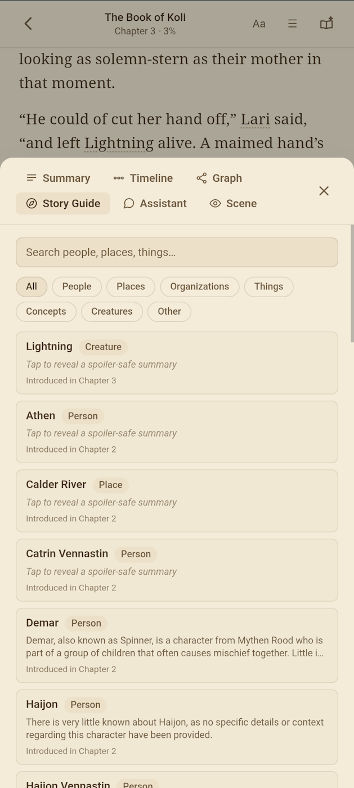 Story Guide</td>
    <td align="center">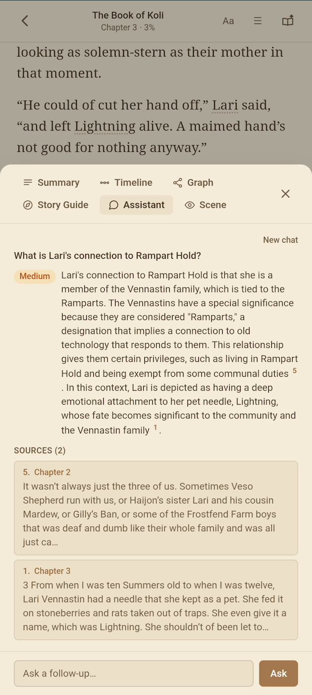 Ask, with sources</td>
    <td align="center">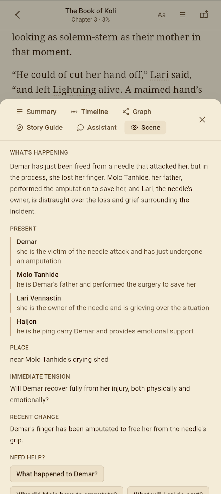 Scene at a glance</td>
  </tr>
</table>

## Library and settings

<table>
  <tr>
    <td align="center">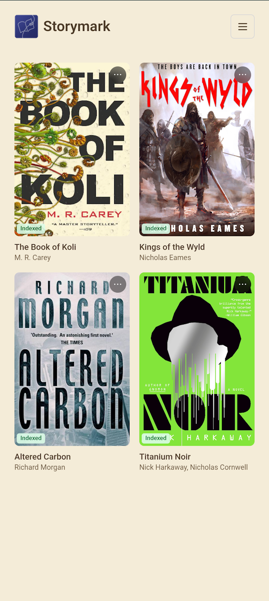 Library</td>
    <td align="center">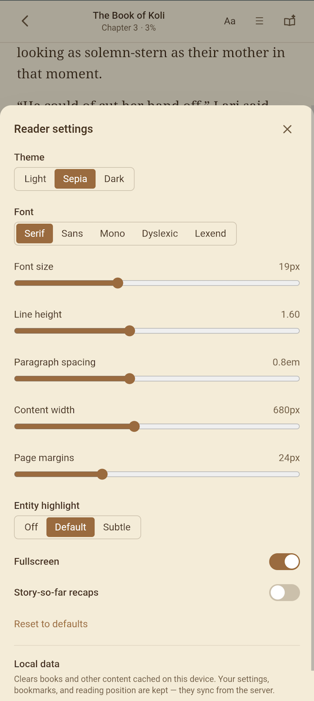 Typography &amp; themes</td>
    <td></td>
  </tr>
</table>

## Admin

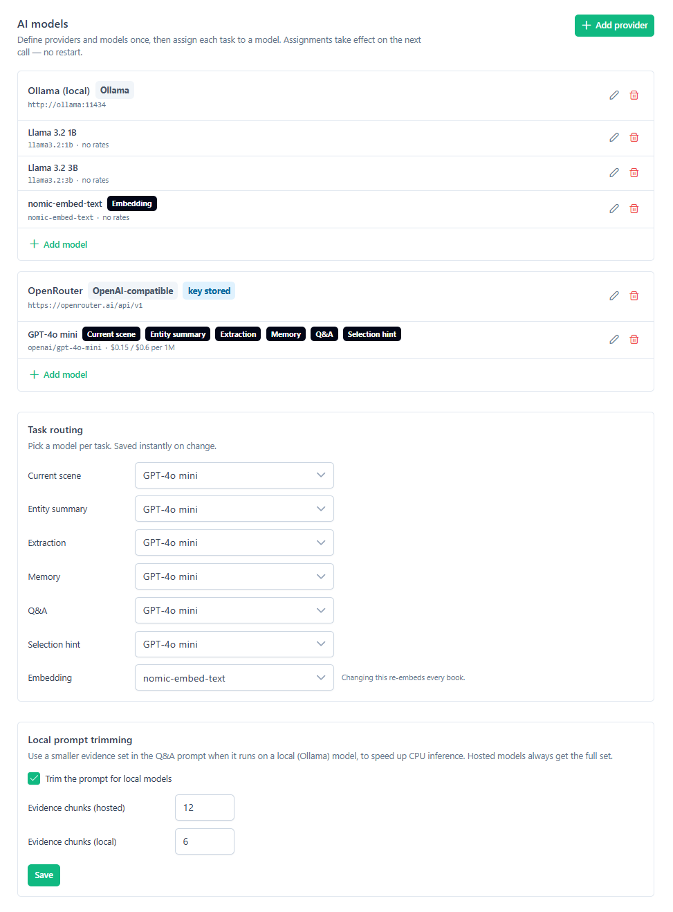

Providers, models, and per-task routing — every chat task can run on a different model, local or hosted, switched at runtime. See <a href="deployment/06-hosted-models.md">hosted models</a> for suggested settings.
